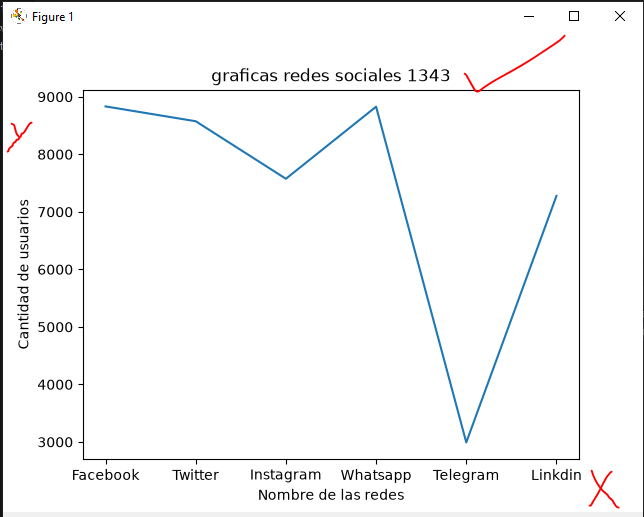
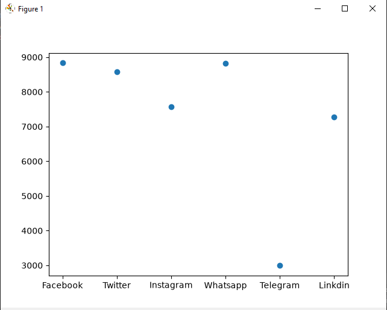
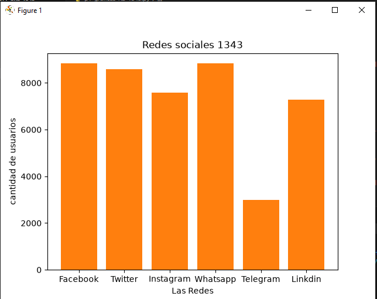
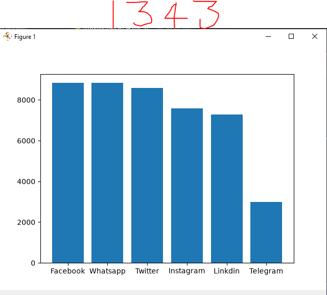
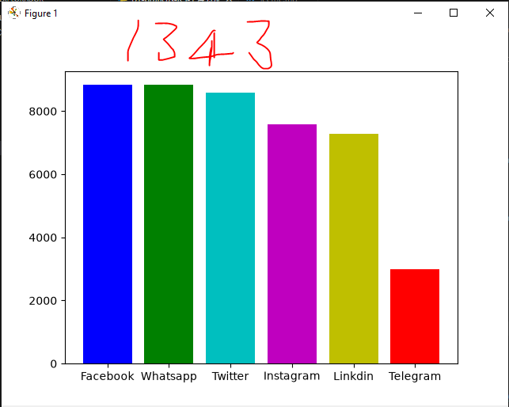
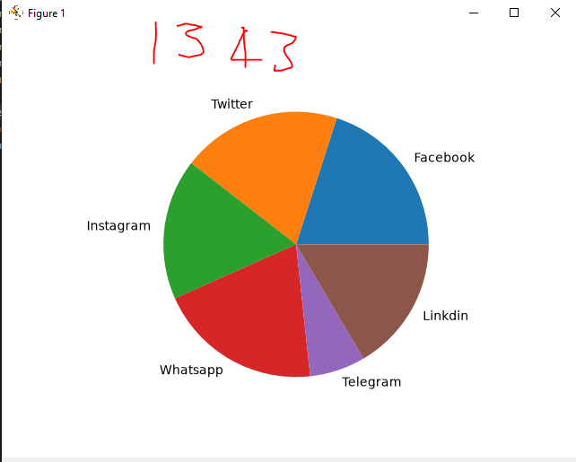

## dataframe o marco der datos

## redes sociales a nivel mundial

# grafica de redes sociales

# grafica puntos de redes sociales

## grafica de barras de redes sociales

## grafica de barras del mas grande al mas chico Descendente

## coloreando la grafica

## grafica pastel
